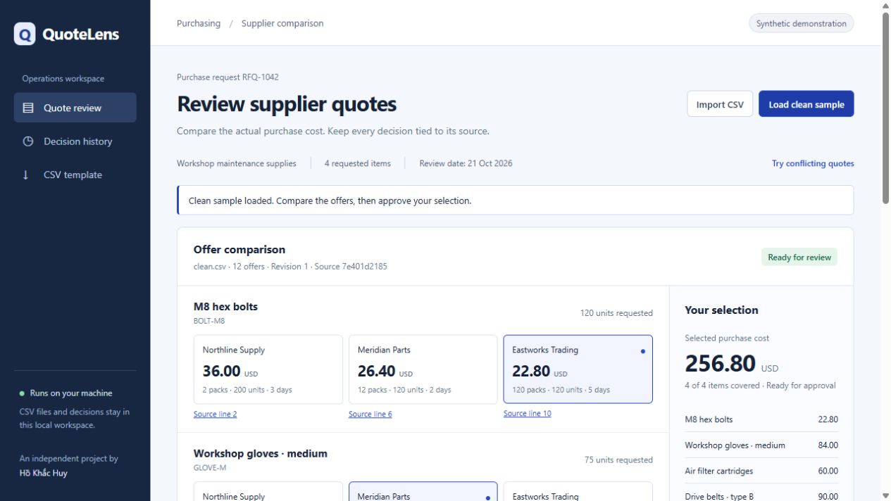

# QuoteLens

**Compare supplier quotes without losing the source behind a decision.**

QuoteLens is a runnable local workbench for reviewing a small purchasing request.
It calculates the cost of the **whole packs actually needed**, excludes invalid
offers, links each number to its original CSV row, and records a review approval
against an exact source and selection version.

Independent, AI-assisted portfolio work by [Hồ Khắc Huy](https://github.com/builtbyhuy),
created 21 October 2026. The suppliers, prices and purchasing request are synthetic.



## Try the complete workflow

Requires Python 3.11 or newer. No package installation, API key or cloud account.

```sh
python quotelens.py
```

Open **http://127.0.0.1:8767**.

1. Start with the conflicting sample. Drive belts have insufficient stock, an
   expired quote and conflicting duplicate identities. Approval stays blocked.
2. Open **Source line** to inspect the original fields behind a price or error.
3. Choose **Load clean sample**, or import `samples/clean.csv`. The lowest eligible
   USD selection costs **256.80** for the four synthetic request items, excluding
   freight and tax. This is a fixture calculation, not a customer saving.
4. Change a supplier offer, approve the selection, then export the decision CSV
   and JSON receipt. Exports retain source line numbers and source/snapshot hashes.
5. Change the approved selection or reimport a CSV. The earlier approval remains
   in history but cannot authorize the new decision.
6. Restart the server. The current source, selection, approval and audit history
   persist in the local SQLite database.

## The problem worth solving

A nominally cheaper unit price can produce a more expensive purchase when pack
sizes differ. A spreadsheet comparison can also hide an expired offer, insufficient
stock, conflicting rows or an approval that belongs to an older source file.

For example, 120 bolts require two 100-unit packs at USD 18 each: **USD 36**, not
USD 21.60. A 10-unit pack at USD 2.20 requires twelve packs: **USD 26.40**.
QuoteLens preserves that calculation beside the selected offer and original row.

## What actually works

- CSV import with schema, row-count, field-length and numeric bounds.
- Decimal arithmetic, whole-pack rounding and quantity/availability checks.
- Duplicate supplier/quote/item detection, expiry checks and currency boundaries.
- A source inspector showing untouched original fields and physical CSV line spans.
- Explicit offer selection, optimistic revision checks and immutable approval receipts.
- Transactional SQLite storage; repeated or concurrent approval of one revision
  returns the same receipt.
- Reapproval after a source or selection change; older decisions remain auditable.
- Decision CSV and JSON receipt exports. CSV text cells are escaped against
  spreadsheet formula interpretation.
- Responsive browser interface with loading, error, blocked and approved states.

## Inspect the engineering

- [Domain, storage and HTTP boundary](quotelens.py)
- [Browser interface](web/)
- [Synthetic clean and conflict cases](samples/)
- [Executable checks](tests/test_quotelens.py)
- [Architecture and trade-offs](docs/ARCHITECTURE.md)
- [Observed verification and limits](docs/VERIFICATION.md)
- [AI assistance and source provenance](docs/PROVENANCE.md)

Run the focused checks:

```sh
python -m unittest discover -s tests -v
```

## Deliberate scope

This is a **single-user local application**, not a procurement service or a
customer deployment. It uses a fixed four-item synthetic request and a stated
21 October 2026 review date so the sample remains reproducible. Import files
follow the provided schema. PDF/OCR extraction, exchange-rate conversion,
freight/tax comparison, authentication, multi-user authorization and supplier
integrations are outside this version.

The server binds to loopback only and rejects unrelated Host/Origin values.
Do not expose it to a public network. No purchase order, message or payment is
sent. UI verification and synthetic checks do not establish adoption, business
savings or production readiness.

MIT licensed. No third-party runtime assets or customer records are included.
