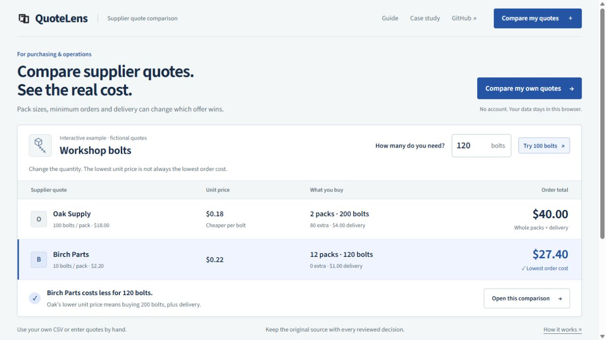

# QuoteLens

**Compare your own supplier offers without losing the source behind a decision.**

[Open the online workbench](https://builtbyhuy.github.io/quotelens-review-workbench/) · [User guide](https://builtbyhuy.github.io/quotelens-review-workbench/guide.html) · [Public case study](https://builtbyhuy.github.io/quotelens-review-workbench/case-study.html)

Independent product by [Hồ Khắc Huy](https://github.com/builtbyhuy), built with AI coding assistance on 21 October 2026. Examples and verification inputs are synthetic. No customer adoption, measured saving, procurement deployment or production readiness is claimed.



[Current mobile interface](docs/evidence/clarity-mobile.png) · [Current design decisions](docs/DESIGN.md) · [Earlier Cosmos redesign checks](docs/evidence/COSMOS-REDESIGN-QA.md)

## Start with one decision

Inspect a complete synthetic review: [six original CSV offer rows](dist/assets/reviewer-offers.csv), [revision 7 receipt](dist/assets/reviewed-receipt.json), and [recorded workflow findings from the earlier ledger interface](docs/evidence/COSMOS-REDESIGN-QA.md). The reviewed request is 37 rings and 11 seals, EUR, 21 October 2026, maximum lead seven days. Orbit Supply plus Documented Seals totals EUR 60.95. Increasing rings to 38 keeps that total but invalidates the earlier approval: input identity matters even without a price change. Those captures retain their original interface and execution scope; [current first-use desktop and phone checks](docs/evidence/TASK-FIRST-UI-QA.md) cover the shipped opening experience.

The [independent calculation comparison](docs/evidence/ENGINEERING-EVALUATION.md) covers 15 fixed synthetic cases and 33 offer rows, with a separate rational reference, handwritten expectations and revision/content controls. It is reproducible engineering evidence, not a claim of customer savings.

## Online product: your request, your offers

The browser product opens on an overview with an interactive, explicitly fictional supplier comparison and links to saved workspaces. **Compare my quotes** creates an empty workspace for arbitrary purchase requests. Enter offers manually or map your own CSV columns, compare the whole packs you would buy, inspect the source and record the reviewed revision. **Open this comparison** instead creates a separate editable workspace with the exact quantity and offers shown in the example. Trying quantities alone does not save or overwrite a workspace.

- User-created workspaces with a review date, one currency and arbitrary request items.
- Generic CSV column mapping and manual offer entry, preserving original fields and physical CSV row references.
- Exact `BigInt` money: whole-pack rounding, minimum pack orders and a delivery fee for each offer line.
- Explicit eligibility and warnings for stock, expiry, lead time, duplicate identities, currency and invalid values. Missing stock, lead time and validity remain unverified. An unmapped delivery-fee column explicitly defaults to zero; enter a known fee rather than treating that default as a supplier promise.
- Explicit selection, optional reasons, revision-specific local approvals and historical input snapshots.
- IndexedDB persistence, visible save failures, decision CSV/receipt exports and validated workspace JSON backup/restore.

Read the [current architecture and reviewer guide](docs/ARCHITECTURE-V2.md), [domain rules](docs/CORE.md) and [v2 case study](docs/CASE-STUDY-V2.md). The historical Python implementation below is a separate local prototype with a fixed synthetic request.

## Use the browser workflow

The interface connects the purchase request, supplier offers and reviewed decision. An explicitly fictional calculation shows why the lowest unit price need not produce the lowest whole-pack cost plus entered delivery fees per offer line. Taxes, FX and shared supplier-order freight are outside that comparison. See [current design decisions](docs/DESIGN.md) and [inspected sources and rights](docs/DESIGN-SOURCES.md) for the shipped opening experience, layout, typography and interaction choices. The [earlier Cosmos browser record](docs/evidence/COSMOS-REDESIGN-QA.md) and its screenshots describe that historical presentation.

1. From the overview, choose **Compare my quotes** to create a workspace, then set its review date and currency.
2. Add your request items, matching IDs, whole quantities and optional maximum lead times.
3. Add manual offers or import a CSV and map its columns.
4. Inspect whole-pack costs, source rows, blocked offers and unverified facts.
5. Choose eligible offers for every item, review the current revision and acknowledge the remaining unknowns.
6. Export an approved comparison or receipt, and keep a workspace backup outside browser storage.

Changing decision inputs requires a new review. Historical receipts remain snapshots of their original inputs. A receipt is a local record, not a signed purchase order or tamper-proof certificate. The content fingerprint is a canonical string, not a cryptographic hash.

## Run the online version locally

Serve `dist/` with a static server; no package installation or application backend is needed:

```sh
python -m http.server 8080 --directory dist
```

Open **http://localhost:8080**. A modern browser with JavaScript, BigInt and IndexedDB is required. This is separate from the Python application server below.

## Test the current calculation core

Node 18 or newer; no install step:

```sh
node --test tests/core.test.cjs tests/ui-persistence.test.cjs
```

On 21 October 2026, **32 checks passed: 23 core tests and nine UI regression tests**. The core checks cover novel arbitrary inputs, exact money, pack/MOQ/line-fee rules, eligibility, CSV boundaries, source provenance, immutable receipts and hostile backup rejection. UI regressions cover note saving, delayed render safety, serialized revision writes, selected-offer warnings, first-use behavior, quantity boundaries and opening the displayed comparison without overwriting saved work. [Current interface checks](docs/evidence/TASK-FIRST-UI-QA.md) distinguish automated checks from actual browser observations.

An earlier online-v2 browser verification used a custom two-item, eight-offer CSV request with an exact selected total of **USD 66.00**. Revision 6 was approved and its exported receipt retained the saved reason. Changing a requested quantity to 24 created revision 7; reverting to 23 created revision 8, which remained unapproved after reload, while the earlier receipt stayed in history. These retained synthetic workflow checks are separate from the current opening-interface checks above; they are not business acceptance, savings or a complete accessibility audit.

[Earlier desktop browser evidence](docs/evidence/desktop-decision.jpg) · [Earlier mobile browser evidence](docs/evidence/mobile-decision.jpg) · [Synthetic exported receipt](docs/evidence/synthetic-browser-receipt.json)

For an inspectable engineering evaluation beyond the regression suite, run:

```sh
node scripts/evaluate-corpus.cjs
```

The [fixed synthetic corpus and expected/actual report](docs/evidence/ENGINEERING-EVALUATION.md) use a separate rational-arithmetic pack enumerator, handwritten expected totals and explicit contract annotations. They include a countercase to nominal unit-price ranking and an unchanged-total quantity edit that still requires a new review. Run with `--write` to regenerate the Markdown/JSON evidence; no install is needed. This evaluates deterministic rules, not customer savings, usability or demand.

## Storage, limits and deliberate scope

Data is saved in IndexedDB on the current browser origin, with explicit save-failure feedback. There is no account, authentication or cloud sync. Export JSON backups before clearing browser data, moving devices or changing origins. Shared local use is not multi-user authorization.

### Moving from the earlier demo address

The current demo address is `https://builtbyhuy.github.io/quotelens-review-workbench/`. If you used the [earlier hosted demo](https://quotelens-huy.hokhachuy1234.chatgpt.site/), open it in the browser where you saved your work, export each workspace as a JSON backup, then use **Import backup** at the current address. Check the restored request, offers and review history before removing an old copy. Browser storage is tied to its origin; changing the address does not move or erase the old data. There is no automatic redirect or background data transfer.

The [Pages workflow](.github/workflows/pages.yml) runs the existing product checks and calculation corpus before publishing only `dist/`. It uses GitHub's built-in workflow token and short-lived Pages identity; no separate deployment secret is required. The earlier release's browser evidence keeps its original address and scope.

The application has no in-app AI, OCR/PDF extraction, exchange-rate conversion, tax calculation, shared supplier-order freight, supplier integration, external messaging, payment or order placement. AI assistance describes development, not the deterministic comparison method. USD/EUR/GBP/VND workspaces use separate currencies and two decimal places, including VND. A delivery fee applies to one offer line. Quantities are whole units.

Practical bounds: 200 request items, 2,000 offers, 64 CSV columns, 2 MiB CSV characters, 8 MiB portable JSON characters and 50 historical receipts. Large snapshots can reach the backup size cap before the receipt count cap. See [CORE.md](docs/CORE.md) for exact limits and validation behavior.

## Tóm tắt tiếng Việt

QuoteLens cho phép tự tạo yêu cầu mua hàng, nhập báo giá bằng CSV có ánh xạ cột hoặc nhập tay, tính đúng số kiện phải mua/MOQ/phí giao theo dòng, kiểm tra dữ liệu và lưu quyết định theo phiên bản. Dữ liệu lưu tại trình duyệt, có xuất/nhập bản sao JSON. Đây là sản phẩm độc lập có AI hỗ trợ lập trình, chưa có bằng chứng khách hàng thực tế hay hiệu quả thương mại.

## Legacy Python prototype (v1)

The following historical instructions are retained for the earlier Python/SQLite application. Its fixed request, source hashes, SQLite storage and historical verification are **not** the online v2 contract. `docs/ARCHITECTURE.md`, `docs/VERIFICATION.md` and `docs/PROVENANCE.md` describe that earlier implementation.

<details>
<summary>Run and inspect the historical local prototype</summary>

**Compare supplier quotes without losing the source behind a decision.**

QuoteLens is a runnable local workbench for reviewing a small purchasing request.
It calculates the cost of the **whole packs actually needed**, excludes invalid
offers, links each number to its original CSV row, and records a review approval
against an exact source and selection version.

Independent, AI-assisted portfolio work by [Hồ Khắc Huy](https://github.com/builtbyhuy),
created 21 October 2026. The suppliers, prices and purchasing request are synthetic.


### Try the complete workflow

Requires Python 3.11 or newer. No package installation, API key or cloud account.

```sh
python quotelens.py
```

Open **http://127.0.0.1:8767**.

1. Start with the conflicting sample. Drive belts have insufficient stock, an
   expired quote and conflicting duplicate identities. Approval stays blocked.
2. Open **Source line** to inspect the original fields behind a price or error.
3. Choose **Load clean sample**, or import `samples/clean.csv`. The lowest eligible
   USD selection costs **256.80** for the four synthetic request items, excluding
   freight and tax. This is a fixture calculation, not a customer saving.
4. Change a supplier offer, approve the selection, then export the decision CSV
   and JSON receipt. Exports retain source line numbers and source/snapshot hashes.
5. Change the approved selection or reimport a CSV. The earlier approval remains
   in history but cannot authorize the new decision.
6. Restart the server. The current source, selection, approval and audit history
   persist in the local SQLite database.

### The problem worth solving

A nominally cheaper unit price can produce a more expensive purchase when pack
sizes differ. A spreadsheet comparison can also hide an expired offer, insufficient
stock, conflicting rows or an approval that belongs to an older source file.

For example, 120 bolts require two 100-unit packs at USD 18 each: **USD 36**, not
USD 21.60. A 10-unit pack at USD 2.20 requires twelve packs: **USD 26.40**.
QuoteLens preserves that calculation beside the selected offer and original row.

### What actually works

- CSV import with schema, row-count, field-length and numeric bounds.
- Decimal arithmetic, whole-pack rounding and quantity/availability checks.
- Duplicate supplier/quote/item detection, expiry checks and currency boundaries.
- A source inspector showing untouched original fields and physical CSV line spans.
- Explicit offer selection, optimistic revision checks and immutable approval receipts.
- Transactional SQLite storage; repeated or concurrent approval of one revision
  returns the same receipt.
- Reapproval after a source or selection change; older decisions remain auditable.
- Decision CSV and JSON receipt exports. CSV text cells are escaped against
  spreadsheet formula interpretation.
- Responsive browser interface with loading, error, blocked and approved states.

### Inspect the engineering

- [Domain, storage and HTTP boundary](quotelens.py)
- [Browser interface](web/)
- [Synthetic clean and conflict cases](samples/)
- [Executable checks](tests/test_quotelens.py)
- [Architecture and trade-offs](docs/ARCHITECTURE.md)
- [Observed verification and limits](docs/VERIFICATION.md)
- [AI assistance and source provenance](docs/PROVENANCE.md)

Run the focused checks:

```sh
python -m unittest discover -s tests -v
```

### Deliberate scope

This is a **single-user local application**, not a procurement service or a
customer deployment. It uses a fixed four-item synthetic request and a stated
21 October 2026 review date so the sample remains reproducible. Import files
follow the provided schema. PDF/OCR extraction, exchange-rate conversion,
freight/tax comparison, authentication, multi-user authorization and supplier
integrations are outside this version.

The server binds to loopback only and rejects unrelated Host/Origin values.
Do not expose it to a public network. No purchase order, message or payment is
sent. UI verification and synthetic checks do not establish adoption, business
savings or production readiness.

MIT licensed. No third-party runtime assets or customer records are included.

</details>


## Earlier visual redesign

An earlier design followed two inspected Cosmos references: [Swiss grid structure](https://www.cosmos.so/e/1795378467) and [an editorial works index](https://www.cosmos.so/e/1312667708). Its ivory ledger, editorial type and folio metadata are preserved in [historical screenshots and workflow findings](docs/evidence/COSMOS-REDESIGN-QA.md); its references are summarized under [superseded design sources](docs/DESIGN-SOURCES.md#superseded-references). They do not describe the current opening experience; see [current design decisions](docs/DESIGN.md).

The earlier Lifemed-inspired glass interface, Manrope font, original glass image and Three.js implementation remain in the repository as historical assets with their licenses. They are not loaded by the current app. Earlier `redesign-*` screenshots and `motion.gif` show that superseded version, not the shipped task-first interface. Domain rules, user data, storage and calculation behavior are preserved.
