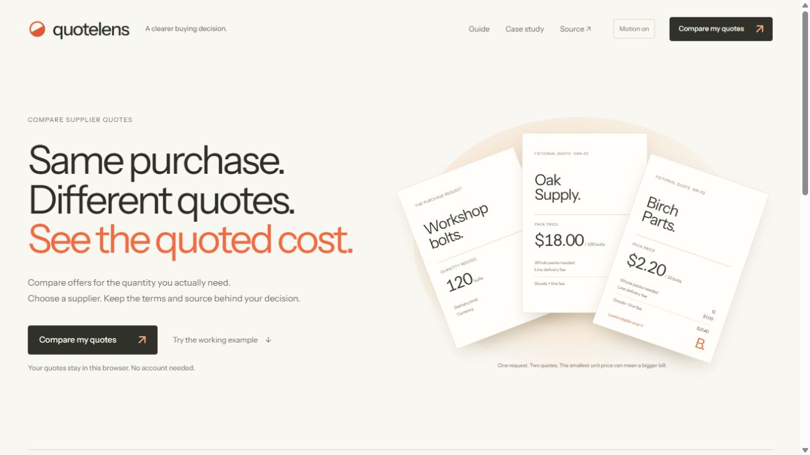

# ATELIER integration — 21 October 2026

User selected the working ATELIER prototype before integration. This record covers the complete browser product, not just that prototype. All supplier names, amounts and input files below are synthetic. Checks do not establish customer demand, savings, production readiness or complete accessibility.

## Functional browser review

The actual UI created a new GBP workspace dated 2026-10-21, two items (41 spacers and seven sleeves, both maximum five days), and imported a nine-row CSV through the file chooser and column-mapping dialog.

- Cobalt: six packs of eight, GBP29.10 goods +1.90 line delivery = **31.00**. Juniper's lower nominal unit price still produced **32.70** for two larger packs.
- Kestrel: the three-pack minimum bought18 sleeves, GBP10.35 goods +0.65 delivery = **11.00**. Complete selected total **GBP42.00**; before selection the UI clearly required a complete selection.
- Expired and missing-required-lead offers were blocked. Both exact duplicate identities were blocked. Missing stock/validity remained visible unverified warnings on a different eligible row.
- Source inspector retained physical row2, original values and the decoded quoted note `Fixture only; quote "rev A"`. Unmapped notes were preserved.
- A selection reason was saved, revision6 reviewed via explicit acknowledgement, and both actual receipt JSON and approved CSV downloaded. Reload preserved the reason, selection and approval.
- **41→42** created revision7: total stayed42.00, approved exports disabled. **42→41** created revision8: still unreviewed, historical revision6 retained. Matching previous contents did not revive an old approval.
- Exported revision8 workspace backup retains both current inputs and historical receipt. The actual file chooser restored that backup through the explicit same-ID replacement dialog; revision8 stayed unreviewed and revision6 remained historical. These are local review records, not signatures or supplier orders.

Inspect [input CSV](../../dist/assets/reviewer-offers.csv), [actual revision6 receipt](../../dist/assets/reviewed-receipt.json), [current workspace backup](selected-workspace-r8.json), [approved CSV](selected-approved-r6.csv) and [changed revision capture](selected-review.png).

## Interface, motion and regression scope

ATELIER uses locally hosted Instrument Sans, warm paper/coral, original request/Oak/Birch HTML papers and the existing calculation core. At120,100,101 units, papers, totals and the lowest marker agree. Quantity changes preserve field focus and do not create saved work. All request/offer/source/decision/history/dialog screens use the selected system.

Owner browser inspection measured390×844 (375px client,375px document scroll width), readable14px working body and16px decision controls. Root independently measured the same phone document boundary and captured the actual page. Laptop1253px client also had no document overflow. Source Escape restored Inspect source focus. This is selected keyboard/responsive coverage, not a full audit.

Manual Motion off kept result feedback still while totals changed. System reduced-motion set motion off, disabled its control and removed paper transition; calculation still worked. Owner observed actual transition properties over time, then settled state. No continuous decorative3D or fluid simulation is claimed.

**32/32 tests** (23core+nineUI regressions) and **15/15 fixed calculation cases,33offer rows** passed after UI freeze. Core and store files remained unchanged. The preview-boundary regression now also checks the papers without adding a nominal test count. Reproduction commands are in the README and ENGINEERING-EVALUATION.md.

[Phone capture](selected-mobile.png). Historical clarity/Cosmos/glass captures remain evidence of their earlier versions only. Publication receipts are kept separately from these local execution findings.
